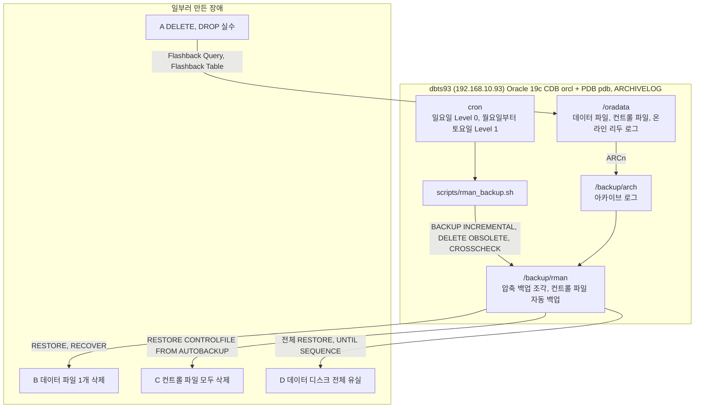

# oracle19c-backup-recovery

직접 구축한 Oracle 19c 서버에 RMAN 증분 백업 체계를 만들고, 장애 5가지를 일부러 일으켜 모두 복구하며 복구 시간과 잃은 데이터를 잰 실습이다.

## 구성도



데이터, 아카이브 로그, 백업을 서로 다른 디스크에 두었다. 데이터 디스크가 통째로 사라져도 백업은 남게 하려는 설계이고, 시나리오 D가 이 설계를 시험했다.

## 한 일

- RMAN 기본 설정을 정했다. 컨트롤 파일 자동 백업, 백업 파일 이름 규칙, 7일 복구 기간 보관, 백업 최적화, 백업된 아카이브 로그만 지우는 정책 (`scripts/rman_config.rman`).
- 증분 백업을 설계했다. 주 1회 Level 0(전체), 매일 Level 1(변경분), 압축 백업셋으로 받는다.
- 백업 스크립트와 cron을 만들었다. 스크립트는 백업, 보관 기간이 지난 백업 삭제, 대조(CROSSCHECK)를 한 번에 하고, 로그에 `RMAN-` 나 `ORA-` 가 있으면 실패로 한 줄 알린다 (`scripts/rman_backup.sh`, `scripts/crontab.txt`).
- `RESTORE DATABASE VALIDATE` 로 백업을 실제로 읽을 수 있는지 미리 확인했다.
- 장애 5가지를 만들고 복구했다. 시나리오마다 백업 뒤에 표시 행을 넣어 두고, 복구 뒤 그 행이 있는지로 어느 시점까지 되살아났는지 판단했다.

| 시나리오 | 만든 장애 | 복구 방법 |
|---|---|---|
| A-1 | 조건을 잘못 쓴 DELETE 후 커밋 | Flashback Query로 과거 시점을 읽어 다시 넣음 |
| A-2 | 테이블 DROP | 휴지통에서 Flashback Table, 인덱스와 제약 조건 이름 복원 |
| B | 운영 중 데이터 파일 1개 삭제 | 해당 테이블스페이스만 오프라인, RESTORE와 RECOVER, DB는 계속 운영 |
| C | 컨트롤 파일 모두 삭제 | 자동 백업에서 컨트롤 파일 복원, 남은 온라인 리두 로그 적용, RESETLOGS |
| D | 데이터 디스크 전체 유실 | 컨트롤 파일과 DB 전체 복원, 마지막 아카이브 로그까지 복구, RESETLOGS |

## 결과 숫자

| 항목 | 결과 |
|---|---|
| 백업 크기 | 4.7GB 데이터를 압축 백업으로 660MB |
| 백업 주기 | 주 1회 Level 0, 매일 Level 1 |
| 보관 | 7일 |
| 복구 | 장애 5가지 모두 복구 |
| RTO | 1~6분 |
| 잃은 데이터 | 리두 로그가 남은 경우 손실 0건, 리두 로그까지 잃은 D는 1건 |

시나리오별 시각 기록은 `docs/backup-recovery-guide.md` 의 결과 정리와 `docs/backup-recovery-log-ch1-3.md` 에 있다.

## 겪은 문제와 해결

### 1. 같은 복구인데 손실이 0건과 1건으로 갈렸다
- 증상: 컨트롤 파일만 잃은 C는 마지막 커밋까지 살아났고, 데이터 디스크를 통째로 잃은 D는 커밋 1건을 잃었다.
- 원인: 차이는 온라인 리두 로그 하나였다. C는 남은 리두 로그를 적용할 수 있었고, D는 리두 로그까지 사라져 마지막 아카이브 로그까지만 복구할 수 있었다.
- 해결: D는 `SET UNTIL SEQUENCE` 로 불완전 복구를 하고 `OPEN RESETLOGS` 로 열었다. 잃을 행을 미리 표시해 두어 예상과 결과가 같은지 확인했다.
- 이유: 리두 로그를 다른 디스크에 다중화해야 하는 이유를 숫자로 확인하려 했다. 다음 개선 항목으로 남겼다.

### 2. Flashback Table 뒤에 인덱스와 제약 조건 이름이 BIN$ 로 남았다
- 증상: 테이블은 원래 이름으로 돌아왔지만 인덱스와 기본 키 제약 조건은 휴지통 이름(`BIN$…`)이었다.
- 원인: Flashback Table은 테이블 이름만 되돌린다.
- 해결: 휴지통의 INDEX 줄 이름을 찾아 `ALTER INDEX … RENAME TO` 로, 제약 조건은 `ALTER TABLE … RENAME CONSTRAINT` 로 원래 이름을 돌려놓았다.
- 이유: 이름이 다르면 이후 운영 스크립트나 모니터링이 객체를 찾지 못한다. 복구 뒤 확인 목록에 넣었다.

### 3. 가이드의 조회문과 자리표시가 오류를 냈다
- 증상: 이름 확인 조회에서 `ORA-00918`, 이름 되돌리기에서 `ORA-01418`, 자리표시를 그대로 실행해 `ORA-23292` 가 났다.
- 원인: 두 뷰에 같은 열 이름이 있는데 별칭을 쓰지 않았고, 휴지통에서 어느 줄의 이름을 써야 하는지 가이드가 분명하지 않았다.
- 해결: 열에 별칭을 붙이고, "INDEX 줄의 BIN$ 이름을 쓴다"고 명시하고, 자리표시를 `<…>` 로 바꿔 가이드를 고쳤다.
- 이유: 장애 중에는 절차서를 그대로 따라 친다. 절차서의 오류가 곧 복구 지연이 된다.

### 4. 설정 하나가 복원 경로를 바꿨다
- 증상: D에서 읽기 전용 PDB$SEED가 가장 최근 백업이 아닌 이전 세대 백업에서 복원됐다.
- 원인: 이미 백업했고 바뀌지 않은 파일은 다시 받지 않는 BACKUP OPTIMIZATION을 켜 두었기 때문이다.
- 해결: 그대로 두었다. RMAN이 RESETLOGS로 세대가 바뀐 뒤에도 알맞은 백업을 스스로 골라 복원했다.
- 이유: 설정이 복구 때 어떻게 작동하는지 알아야 결과를 보고 놀라지 않는다. 가이드에 이 동작을 적어 두었다.

## 따라 하는 법

대상은 ARCHIVELOG 모드의 Oracle 19c다. 설치는 [oracle19c-install](https://github.com/kangyoungsoo-db/oracle19c-install) 저장소를 따른다. 장애 실습 전에는 VM 스냅샷을 찍는다.

oracle 계정에서 RMAN 설정

```bash
rman target / @scripts/rman_config.rman
```

백업 스크립트 설치

```bash
cp scripts/rman_backup.sh /backup/scripts/
```
```bash
chmod 750 /backup/scripts/rman_backup.sh
```
```bash
/backup/scripts/rman_backup.sh 0
```

cron 등록 (`scripts/crontab.txt` 의 두 줄을 넣는다)

```bash
crontab -e
```
```bash
crontab -l
```

백업 확인

```bash
grep -E "Finished backup|RMAN-|ORA-" /backup/logs/rman_L*.log
```

시나리오별 장애 만들기와 복구 명령은 `docs/backup-recovery-guide.md` 의 3장부터 6장까지 순서대로 따른다.

## 폴더

| 위치 | 내용 |
|---|---|
| `scripts/rman_config.rman` | RMAN 기본 설정 |
| `scripts/rman_backup.sh` | Level 0, Level 1 백업 스크립트 |
| `scripts/crontab.txt` | oracle 계정 cron 설정 |
| `docs/backup-recovery-guide.md` | 백업과 장애 5가지 복구 가이드 (실제 화면 포함) |
| `docs/backup-recovery-log-ch1-3.md` | 1장부터 3장까지 실행 기록 |
| `docs/summary.md` | 포트폴리오 요약 |

문서 안의 비밀번호는 모두 `<비밀번호>` 로 바꿔 두었다.
